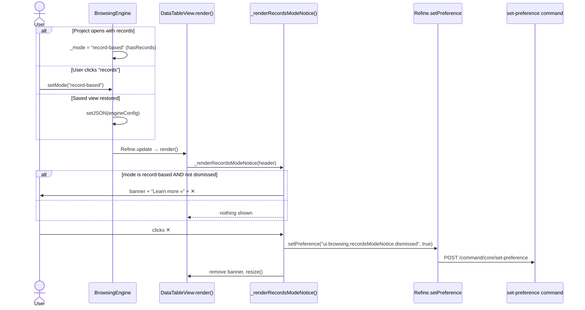

# Design Document: Records Mode Notice

## Overview

We added a **records mode notice** to OpenRefine. When the data grid is shown in records mode, a one-line yellow banner appears under the "Show as: rows | records" toggle. It says that records mode is on, links to the docs page explaining [rows vs. records](https://openrefine.org/docs/manual/exploring#rows-vs-records), and has a ✕ button to dismiss it. Once dismissed, it never appears again in that workspace.

This implements the GitHub issue: *"The first time OpenRefine is switched to the records mode … we should have a small information message somewhere (non-intrusive, easily discardable but well visible) which notifies the user that this mode is enabled and points to a brief description of its difference with the rows mode."*

**Commit:** `f75dc5a89` on branch `records-notice`.

> **To fill in:** items marked _TODO_ need your own details (who drove each step, debugger use, manual checks, personal reflection). We left them blank rather than guess.

---

## Relevant Code Structure

### Modified files

- **`main/webapp/modules/core/scripts/views/data-table/data-table-view.js`**
  - Header markup gets `bind="viewPanelHeader"` so the notice can be added to it
  - `render()` calls `this._renderRecordsModeNotice(elmts.viewPanelHeader)` (line 228)
  - New constants (line 247): `DataTableView.recordsModeNoticePreference` = `"ui.browsing.recordsModeNotice.dismissed"` and `DataTableView.recordsModeDocsUrl`
  - New `_renderRecordsModeNotice(header)` (line 254):
    - Returns early unless the mode is `record-based` and the preference is not `true` / `"true"`
    - Builds the banner: the message, a "Learn more »" link (new tab), and a ✕ with a "Don't show again" tooltip
    - ✕ click: `Refine.setPreference(..., true)`, removes the banner, calls `self.resize()` so the grid regains the space

- **`main/webapp/modules/core/styles/views/data-table-view.css`**
  - `.viewpanel-records-notice` (line 52): own line under the header controls (`clear: both`), yellow `--notification-primary` background
  - `.viewpanel-records-notice-dismiss img` (line 65): 12px close icon

- **`main/webapp/modules/core/langs/translation-en.json`**
  - `core-views/records-mode-notice`: "This project is shown in records mode: rows are grouped into records based on the first column."
  - `core-views/records-mode-notice-dismiss`: "Don't show again"
  - Reused existing key `core-project/learn-more` ("Learn more »") for the link text

- **`main/tests/cypress/cypress/e2e/project/grid/viewpanel-header/rows_records.cy.js`**
  - Fixed an existing assertion that counted `span:contains("records")`, which the notice would have broken
  - New `describe('records mode notice')` block (line 43) with 4 tests; saves the preference before and restores it after

### Existing code we built on (not changed)

| File | What it gave us |
|---|---|
| `scripts/project/browsing-engine.js` | `_mode` set from `recordModel.hasRecords` (line 36); `setMode` / `setJSON` |
| `modules/core/.../model/RecordModel.java` | `hasRecords()`: true when there are fewer records than rows |
| `scripts/project.js` | `Refine.getPreference` / `setPreference` (lines 251–273); history-erasure warning pattern |
| `scripts/index.js` | Update-check banner: a non-modal notice saved as a preference |
| `scripts/project/process-panel.js` | `#notification` box (progress/undo); shows why we didn't reuse it |
| `scripts/facets/list-facet.js` | ✕ button with translated `title` tooltip (pattern for our dismiss button) |
| `modules/core/.../preference/PreferenceStore.java` | `loadObject()`: confirms a saved `true` comes back as a boolean |

---

## Diagram

---

## 1. Feature Exploration

### How we familiarized ourselves with OpenRefine

- Read the GitHub issue and the linked docs section ([Rows vs. records](https://openrefine.org/docs/manual/exploring#rows-vs-records))
- Read `AGENTS.md` for the build, test and lint commands
- Asked the agent to find where records mode is set and which notice/dialog patterns already exist before choosing anything
- _TODO: any hands-on use of OpenRefine (importing JSON/XML, trying the rows/records toggle)_

### Requirement decisions

The issue leaves room for interpretation. We went through the decisions one at a time. For each one the agent found existing patterns and suggested options, and we chose.

| # | Question | Options considered | Decision and why |
|---|---|---|---|
| 1 | What triggers it? | (A) any time the grid is in records mode, checked in `render()`; (B) only when a project opens in records mode; (C) hook in `BrowsingEngine` | **A.** One check covers project open, a manual switch, and restored state. The issue's "for instance when importing" reads as an example, not a limit |
| 1b | Show once, or until dismissed? | (A) until dismissed; (B) once, then auto-mark as seen | **A.** Matches the history-erasure warning and update-check banner, which both keep showing until the user acts. B has no precedent and is easy to miss |
| 2 | Where does it appear? | (A) inline in `.viewpanel-header`; (B) reuse `#notification`; (C) modal dialog; (D) summary bar | **A.** Next to the toggle it explains and non-modal. B fades after 10 s and gets overwritten; C is intrusive; D is cramped and cleared on every update |
| 3a | Dismiss control | (A) ✕ + "Don't show again" tooltip; (B) "Got it" link; (C) both | **A.** Same as the facet-remove and project-delete buttons. The tooltip makes clear it's permanent |
| 3b | Does the docs link dismiss it? | (A) yes; (B) no | **B.** Links in the update-check banner don't dismiss it either; only explicit actions do |
| 3c | In rows mode? | (A) hidden, not dismissed; (B) switching counts as dismissing | **A.** Follows from 1b |
| 4a | How is the dismissal saved? | (A) `Refine.setPreference`; (B) cookie; (C) `localStorage` | **A.** The existing "don't show again" mechanism. Works in any browser, and tests can preset it |
| 4b | Scope | (A) whole workspace; (B) per project | **A.** The concept only needs learning once, and every preference is workspace-wide |
| 5 | Text and link | (A) hard-coded URL + reused `learn-more` key; (B) link inside the translated string; (C) new link key | **A.** Matches how the codebase links to docs; the link text is already translated |
| 6 | Testing approach | (A) hide the banner in all other specs; (B) no hiding, fix assertions that break | **B.** We were sceptical of A: no spec would test the real UI, and the codebase doesn't hide the history-erasure warning |

---

## 2. Comprehension Process

### Navigation path

1. **Find the mode:** searched for `recordBased|"record-based"` → `browsing-engine.js:36` (mode from `hasRecords`) and `data-table-view.js:226` (toggle links)
2. **Find what triggers a mode change:** searched for `setMode|getMode` → `setMode`, `setJSON`, and that all paths end in `DataTableView.render()`
3. **Find out when `hasRecords` is true:** searched for `hasRecords` in Java → `RecordModel.java:109`. Discovered that a CSV with blank cells in the first column also opens in records mode
4. **Find existing notices:** searched for `notification|toast|banner|dismiss` → `index.js` (update-check banner), `process-panel.js` + `progress-panel.html` (undo/progress `#notification`), `project.js` (history-erasure modal)
5. **Find how "don't show again" is stored:** searched for `setPreference|getPreference|localStorage|Cookies` → `project.js:251`; then read `SetPreferenceCommand` and `PreferenceStore.loadObject()` to see what type comes back
6. **Check the header layout:** read `render()` and `resize()`. Found that the header is rebuilt on every update and that `resize()` measures the header height
7. **Find patterns for the ✕ and the link:** searched for `close.svg|facet-title-remove` and `openrefine.org/docs|learn-more`
8. **Find tests to extend:** searched Cypress specs for `records`, `setPreference`, `notification` → `rows_records.cy.js`, `warn_for_history_deletion.cy.js`, `wikibase_schema.cy.js` (save/restore preference)

### Important commands

| Command | Purpose |
|---|---|
| `grep -rn "<term>" main/webapp/modules/core/scripts` | Find code by keyword |
| `sed -n 'START,ENDp' <file>` | Read a range of lines |
| `git show HEAD:<file>` / `git diff --stat` | Compare against the committed version |
| `node --check <file.js>` | Syntax-check JavaScript |
| `npx prettier@3.9.10 --check --end-of-line auto <spec>` | Check Cypress formatting |
| `./refine build` | Build OpenRefine |
| `refine.bat /p 3334 /d <empty dir>` | Start an isolated test server |
| `node node_modules/cypress/bin/cypress run --spec <spec> --env OPENREFINE_URL=http://127.0.0.1:3334` | Run one Cypress spec |

### Debugger breakpoints

_TODO: list any breakpoints you set (e.g. in `_renderRecordsModeNotice` or `BrowsingEngine.setMode`). The agent session used no debugger; it worked from code search and test output._

---

## 3. Implementation Process

| # | Step | Driver | Navigator |
|---|---|---|---|
| 1 | Explore the codebase and list the existing patterns | _TODO_ | _TODO_ |
| 2 | Make design decisions 1–6, one at a time | _TODO_ | _TODO_ |
| 3 | Add `_renderRecordsModeNotice()` and call it from `render()` | _TODO_ | _TODO_ |
| 4 | Add CSS and the two i18n keys | _TODO_ | _TODO_ |
| 5 | Fix the brittle assertion and add 4 Cypress tests | _TODO_ | _TODO_ |
| 6 | Check syntax and formatting | _TODO_ | _TODO_ |
| 7 | Build, start the test server, run `rows_records.cy.js` | _TODO_ | _TODO_ |
| 8 | Commit (`f75dc5a89`) | _TODO_ | _TODO_ |

**Role switches:** _TODO: when you switched and why_

**How the roles affected the experience:** _TODO_

---

## 4. Running and Testing

### Automated tests (`rows_records.cy.js`): 6 / 6 passing

| Test | Expected output | Result |
|---|---|---|
| Existing: rows and records same for CSV | 10 rows in both modes | ✅ |
| Existing: rows and records differ for JSON (assertion fixed) | "records" in the selected toggle, summary bar and page size | ✅ |
| Notice with docs link in records mode | Banner visible; link `href` correct, `target="_blank"`; ✕ tooltip "Don't show again" | ✅ |
| Hidden in rows mode, back in records | Banner gone in rows, visible again in records | ✅ |
| CSV switched to records manually | No banner in rows; banner after clicking "records" | ✅ |
| Dismissed stays dismissed after reload | Banner gone after ✕ and still gone after reload | ✅ |

Tests ran against a separate server on port 3334 with an empty workspace, so the real workspace on port 3333 was never touched. The full suite is left to the pull request's checks.

### Manual verification

_TODO: what you checked in the browser (e.g. banner position, grid not cut off after dismissing, link opens the right page)_

### Edge cases

| Edge case | How we handled it |
|---|---|
| CSV with blank first-column cells opens in records mode | Counts as records mode; the notice shows (the users who most need it) |
| Header is rebuilt on every update | The notice is redrawn from state on each `render()` instead of being added once |
| Grid height after dismissing | Call `resize()`, which re-measures the header |
| Preference may come back as `"true"` (string) | Check accepts both `true` and `"true"` |
| Switching back to rows | Hidden but not dismissed |
| Existing test counted every `span` containing "records" | Changed it to check the specific labels |
| Tests share one workspace, so the dismissal persists between tests | Save the value in `before()`, delete it in `beforeEach()`, restore it in `after()` |
| Clicking the docs link | Doesn't dismiss; only checks `href` and `target` |

### Write → Run/Test → Debug loop

| Write | Run/Test | Obstacle | Fix |
|---|---|---|---|
| Notice, CSS, strings, tests | `node --check`, JSON parse | none | none |
| Spec | `prettier --check` | Reported style issues | Only Windows CRLF line endings; passes with `--end-of-line auto`, and git stores LF |
| none | `./refine build` | Malformed POM: `Expected root element 'project' but found 'build'` in `modules/grel/pom.xml` | Unrelated uncommitted edit; stopped and asked; it was fixed by hand |
| none | `./refine` (Git Bash) | `ClassNotFoundException: com.google.refine.Refine` | Bash launcher's classpath doesn't work on Windows; used `refine.bat` |
| none | `refine.bat /x refine.headless=true` | `Unknown Refine command called "true"` | Batch splits arguments at `=`; passed `JAVA_OPTIONS=-Drefine.headless=true` instead |
| none | `yarn install` | Project needs Yarn 4 (`packageManager`), global Yarn is 1.22 | `npx corepack yarn install` (Node 25 doesn't ship Corepack) |
| none | `yarn cypress install` | `EBADF: bad file descriptor` | Yarn Plug'n'Play doesn't work on Node 25; reinstalled with `YARN_NODE_LINKER=node-modules` |
| none | `cypress run` | 6 / 6 passing | none |

---

## 5. Obstacles Encountered

1. **Broken build from an unrelated file.** `modules/grel/pom.xml` had a half-finished uncommitted edit. *Strategy:* read the Maven error, compared line counts with `git show HEAD:`, and stopped to ask instead of changing someone else's work. *Fix:* the file was restored by hand.
2. **`./refine` fails on Windows.** `ClassNotFoundException`. *Fix:* use `refine.bat`. *For next time:* on Windows, always launch with `refine.bat`.
3. **`refine.bat` breaks `name=value` options.** Batch files treat `=` as an argument separator. *Fix:* set `JAVA_OPTIONS` in the environment before calling `refine.bat`.
4. **An OpenRefine instance already running on port 3333.** Tests would have changed the real workspace's projects and preferences. *Fix:* separate server on port 3334 with an empty data directory (`/p 3334 /d <dir>`).
5. **Yarn version mismatch and Plug'n'Play crash on Node 25.** *Fix:* `npx corepack yarn install` with `YARN_NODE_LINKER=node-modules`, then delete the stray `.pnp.cjs` / `.pnp.loader.mjs`. *For next time:* use Node 24, which the project targets.
6. **An existing test would break.** `span:contains("records")` counted 3 spans; the banner adds a fourth. *Fix:* point the test at the specific elements.

Resources used to overcome these: error messages, reading `refine` / `refine.bat` and `package.json`, and the agent. _TODO: add any forum posts, peers or office hours._

---

## 6. Resources Consulted

| Resource | What we learned |
|---|---|
| **Claude Code (agentic tool)** | Searched the codebase, listed existing patterns with file and line references, laid out options with pros and cons, implemented the agreed design, and ran the build and tests |
| GitHub issue | The requirement: non-intrusive, easily dismissed, well visible, linking to the docs |
| [OpenRefine docs: Rows vs. records](https://openrefine.org/docs/manual/exploring#rows-vs-records) | The page the notice links to |
| `AGENTS.md` | Build, test and lint commands; translations go only in the English file (Weblate does the rest) |
| Existing code (`index.js`, `project.js`, `process-panel.js`, `list-facet.js`) | Patterns for notices, "don't show again" preferences and ✕ buttons |
| Existing tests (`warn_for_history_deletion.cy.js`, `wikibase_schema.cy.js`) | How similar features are tested; how to save and restore a preference in a spec |
| _TODO_ | _Peers, office hours, other web resources_ |

---

## 7. Reflection

### How we worked with AI

- **The agent did:** codebase search, finding precedents, laying out options and tradeoffs, writing the code and tests, and running the build and tests.
- **We did:** made every design decision. We went through them one by one and asked for concise answers.
- **We pushed back:**
  - Asked whether "show every time" matched existing patterns. This led to the "show until dismissed" comparison.
  - Asked whether the ✕ and the link behaviour had precedents.
  - Questioned hiding the banner in other end-to-end specs. The agent changed its recommendation.
- **Guardrails we set:** the agent had to stop and ask at major decisions. It did so for the broken `pom.xml` and for how much of the test suite to run.

### Managing context while pair programming

_TODO: how you split attention between the agent's output, the code and your partner_

### What we learned from writing this journal

_TODO_

### Takeaways for future work

- Look for an existing pattern before designing anything new. Most of our decisions came down to "what does OpenRefine already do?"
- Ask "is this consistent with the codebase?" whenever the AI recommends something.
- Run tests against an isolated workspace, never your real one.
- _TODO: your own takeaways_
