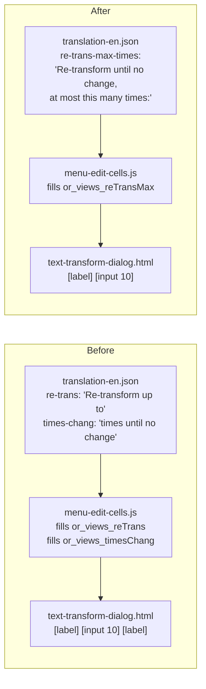

# Design Document

## Overview

Two labels in OpenRefine's UI were built from two separately translated strings with an input box between them:

- **Transform dialog:** "Re-transform up to **[10]** times until no change"
- **Line-based importer:** "Parse every **[1]** lines into one row"

Translators saw each half on its own and could not reorder the sentence around the box, so some languages came out wrong. For example, Japanese lost "up to", and German translated "times" as "Zeiten" (time periods) instead of "Mal". This change replaces each split label with one full sentence placed before its input:

- "Re-transform until no change, at most this many times: **[10]**"
- "Number of lines to treat as a single row: **[1]**"

This addresses issue [#8081](https://github.com/OpenRefine/OpenRefine/issues/8081), part of [#1858](https://github.com/OpenRefine/OpenRefine/issues/1858).

## Relevant Code Structure

Each UI label in OpenRefine is spread across three layers:

| Layer | Role |
| --- | --- |
| `translation-en.json` | Maps a key to its English sentence |
| A `.js` file | Looks up the sentence for a key with `$.i18n()` and puts it into a named slot |
| A `.html` file | Defines the empty slots and the input box, in order |

### Files changed

- **`main/webapp/modules/core/scripts/views/data-table/text-transform-dialog.html`**
  Replaced the two labels `or_views_reTrans` and `or_views_timesChang` around `repeatCountInput` with one label, `or_views_reTransMax`, before the input.
- **`main/webapp/modules/core/scripts/views/data-table/menu-edit-cells.js`**
  In `doTextTransformPrompt()`, replaced the two `.text()` calls with one that fills `or_views_reTransMax` with `core-views/re-trans-max-times`.
- **`main/webapp/modules/core/scripts/views/data-table/data-table-view.js`**
  Has its own copy of `doTextTransformPrompt()` for the **All → Transform…** menu, which loads the same HTML. Made the same change there.
- **`main/webapp/modules/core/scripts/index/parser-interfaces/line-based-parser-ui.html`**
  Replaced the spans `or-import-parseEvery` and `or-import-linesIntoRow` around `linesPerRowInput` with one `<label for="$lines-per-row">` (`or-import-linesPerRow`), and gave the input the matching `id`. Also fixed a missing space before `spellcheck`.
- **`main/webapp/modules/core/scripts/index/parser-interfaces/line-based-parser-ui.js`**
  In `_initialize()`, replaced the two `.html()` calls with one `.text()` call that fills `or-import-linesPerRow` with `core-index-parser/lines-per-row`.
- **`main/webapp/modules/core/langs/translation-en.json`**
  Added `core-views/re-trans-max-times` and `core-index-parser/lines-per-row`. Removed `core-views/re-trans`, `core-views/times-chang`, `core-index-parser/parse-every` and `core-index-parser/lines-into-row`.

## Diagram

How each label reaches the screen, before and after:

`data-table-view.js` (All → Transform…) fills the same slot the same way as `menu-edit-cells.js`. The importer label follows the same pattern: `translation-en.json` → `line-based-parser-ui.js` (`_initialize()`) → `line-based-parser-ui.html`.

## Key Design Decisions

### Decision 1: Which issue to work on

**Problem:** I needed a small, unclaimed issue that could be finished and that maintainers would accept.

**Options considered:**

- **Assigned or claimed issues** (e.g. #3645, scikit-learn #30537): already had someone working on them or an open PR.
- **Issues without agreement** (e.g. #3360): maintainers disagreed on whether the change should be made.
- **The remaining work in #1858 (chosen):** labeled Good First Issue, unassigned, with the fix already described by a maintainer (tfmorris), and maintainers replying recently.

**Decision:** I chose #1858. The agent checked which candidate issues were taken, stale or disputed; I chose this one because the expected fix was clearly defined and the maintainers were active.

---

### Decision 2: One complete sentence vs. reordering the pieces

**Problem:** The bug is that the sentence is split around the input.

**Options considered:**

- **Move the input to the end, keep two strings:** fewer edits, but translators still see two fragments, and the English becomes "Re-transform up to times until no change".
- **One template string with a placeholder (`$1`) for the input:** keeps the input in the middle, but injecting an HTML input through the i18n template is fragile and harder to read.
- **One complete label before the input (chosen):** translators get a whole sentence and can phrase it naturally; the HTML stays simple.

**Decision:** I chose one label before the input, which is the approach tfmorris suggested in #1858. I first tried simply moving the input; the agent pointed out it still left two fragments.

---

### Decision 3: New keys vs. editing the old keys' text

**Problem:** The English text changes, so the keys could either be reused or replaced.

**Options considered:**

- **Reuse `core-views/re-trans` with new text:** fewer key changes, but every existing translation of that key is a fragment ("Re-transform up to") and would show beside a sentence that no longer matches.
- **New keys, remove the old ones (chosen):** other languages fall back to English until translators translate the new sentence, so no mismatched fragment is ever shown.

**Decision:** I chose new keys. The agent pointed out that old translations would no longer fit the new sentence.

---

### Decision 4: Which translation files to change

**Problem:** OpenRefine has a translation file per language.

**Options considered:**

- **Edit every language file:** I cannot write correct translations for other languages, and copying English into them works against the community translation workflow.
- **Only `translation-en.json` (chosen):** follows OpenRefine's convention; missing keys fall back to English, and translators update the other files.

**Decision:** I chose `translation-en.json` only, following the existing convention the agent identified.

---

### Decision 5: `` vs. `<label for>` in the importer

**Problem:** The importer's text was in `` elements not linked to the input.

**Options considered:**

- **Keep a single ``:** smallest change, still fixes translation.
- **`<label for>` linked to the input (chosen):** clicking the text focuses the box and screen readers announce it, matching the Transform dialog, which already uses `<label for>`.

**Decision:** I chose `<label for>`. The agent suggested it; I kept it because it matches the surrounding code and costs one extra attribute.

---

### Decision 6: Scope and PR structure

**Problem:** The import screen has several more split labels ("Ignore first [n] line(s)…", "Discard initial [n] row(s)…"), and there were two labels to fix.

**Options considered:**

- **Fix every split label at once:** a larger PR that is harder to review; a maintainer asked contributors to keep changes focused.
- **Two separate PRs, one label each:** two reviews for near-identical changes.
- **One PR with both labels (chosen):** one review for one consistent pattern, still small.

**Decision:** I chose one PR covering both labels. The agent recommended leaving the remaining import-screen labels for follow-up PRs to keep this one focused.
