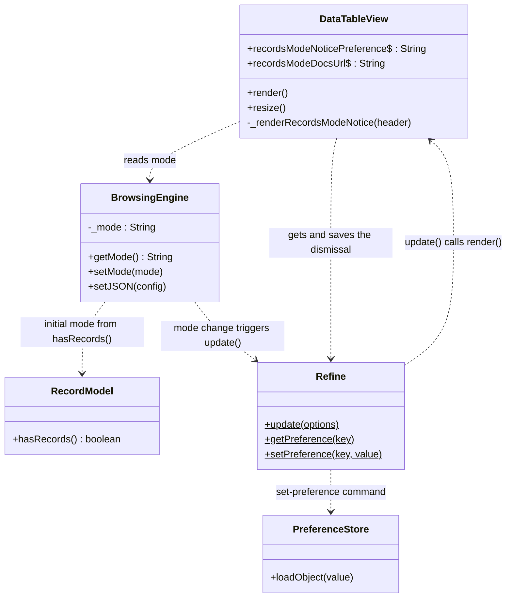
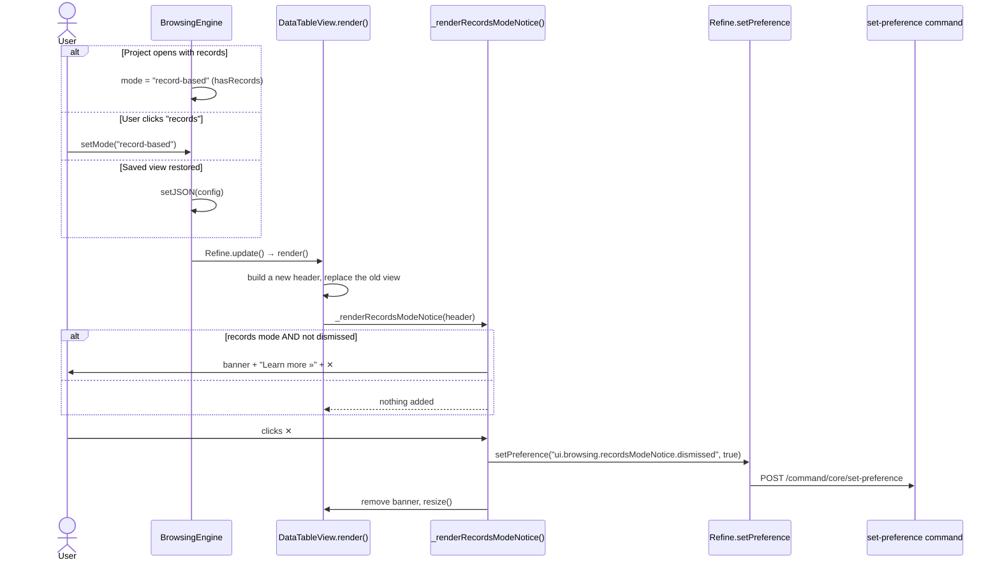

# Design Document: Records Mode Notice

**Authors:** Kaley Chung and Ethan Pham
**Issue:** [OpenRefine #3360](https://github.com/OpenRefine/OpenRefine/issues/3360) · **Pull request:** [OpenRefine #8104](https://github.com/OpenRefine/OpenRefine/pull/8104)

## Overview

When OpenRefine shows a project in records mode, rows are grouped into records based on the first column. Users often don't notice this mode is on, so moving a different column to the front can seem to "regroup" their data at random. That confusion is what issue #3360 reported.

The maintainers said the grouping behavior is intended. They asked for a small, easy-to-dismiss message instead. We added a one-line banner under the "Show as: rows | records" toggle. It appears whenever the grid is in records mode, links to the [Rows vs. records](https://openrefine.org/docs/manual/exploring#rows-vs-records) docs page, and has a ✕ that hides it for good in that workspace.

The change is entirely in the frontend: one function in the grid view, some CSS, two translation strings and Cypress tests. No Java code changed.

## Relevant Code Structure

### Modified files

- **`main/webapp/modules/core/scripts/views/data-table/data-table-view.js`**
  - `render()` now calls `_renderRecordsModeNotice(header)` after it builds the header.
  - New `_renderRecordsModeNotice(header)`:
    - Does nothing unless the mode is `record-based` and the dismissal preference isn't set.
    - Adds the banner: the message, a "Learn more »" link (new tab) and a ✕ button with a "Don't show again" tooltip.
    - Clicking ✕ calls `Refine.setPreference(..., true)`, removes the banner and calls `resize()` so the grid takes back the space.
  - Two new constants: `DataTableView.recordsModeNoticePreference` (`"ui.browsing.recordsModeNotice.dismissed"`) and `DataTableView.recordsModeDocsUrl`.

- **`main/webapp/modules/core/styles/views/data-table-view.css`**
  - `.viewpanel-records-notice`: puts the banner on its own line under the header controls, with the yellow `--notification-primary` background.
  - `.viewpanel-records-notice-dismiss img`: sizes the close icon.

- **`main/webapp/modules/core/langs/translation-en.json`**
  - `core-views/records-mode-notice`: the banner message.
  - `core-views/records-mode-notice-dismiss`: "Don't show again".
  - The link reuses the existing `core-project/learn-more` key.

- **`main/tests/cypress/cypress/e2e/project/grid/viewpanel-header/rows_records.cy.js`**
  - Fixed an existing assertion that counted every `span` containing "records", which the banner broke.
  - Added 7 tests for the notice (see Decision 8). The spec saves the user's preference before the tests and restores it after.

### Existing code we relied on (unchanged)

- **`BrowsingEngine`** (`browsing-engine.js`) holds the current mode. It's set from `RecordModel.hasRecords()` when a project loads, by `setMode()` when the user clicks the toggle, and by `setJSON()` when a saved view is restored.
- **`RecordModel.hasRecords()`** (Java) is true when a project has fewer records than rows.
- **`Refine.getPreference` / `Refine.setPreference`** (`project.js`) save workspace-wide settings through the `set-preference` command.
- **`DataTableView.render()`** rebuilds the whole view from scratch on every update and replaces the old one with `this._div.empty().append(...)`.

## Diagrams

### Class diagram

`DataTableView` is the only class we changed. We added `_renderRecordsModeNotice()` and its two constants, and one call to it in `render()`.

### Sequence diagram

## Key Design Decisions

**How we made every decision:** for each question, we asked Claude for the options, the pros and cons of each, and its recommendation. We read them, discussed them and made the decision ourselves (Kaley and Ethan). Below, "why" is our reason for the choice.

### Decision 1: Explain records mode instead of changing it

**Problem:** The issue first asked for records to stop regrouping when the first column changes.

**Options considered:**
- **Change how records are formed**
  - Pros: Removes the surprise at its source.
  - Cons: The maintainers said the behavior is intended. Changing it would break workflows that depend on it and would be a much larger change.
- **Add a message that explains records mode (chosen)**
  - Pros: What the maintainers actually asked for. Small, low-risk and frontend-only.
  - Cons: Users still have to read the message and the docs to understand the behavior.

**Decision:** We added the message. We chose it after reading the issue thread, where the maintainers called the behavior intended and asked for a "small information message."

### Decision 2: When the notice appears

**Problem:** The notice could be tied to one event or to the mode itself.

**Options considered:**
- **Only when a project is created in records mode**
  - Pros: Shows at the moment users first meet the mode.
  - Cons: Misses users who switch to records later, and users who reopen a saved project.
- **Only when the first column is swapped**
  - Pros: Targets the exact action from the issue.
  - Cons: By then the user is already confused. It also needs new hooks into column moves.
- **A hook inside `BrowsingEngine` on mode changes**
  - Pros: Reacts to every mode change.
  - Cons: Puts UI code in the engine, and still misses the mode a project opens in.
- **Any time the grid draws in records mode, checked in `render()` (chosen)**
  - Pros: One check covers opening a project, clicking "records" and restoring a saved view, because all three end in `render()`.
  - Cons: The check runs on every redraw, though it's only a mode and preference lookup.

**Decision:** We chose the check in `render()`, because one simple check covers every way of entering records mode.

### Decision 3: Show once, or until dismissed

**Problem:** We had to decide how long the notice keeps appearing, and what switching to rows mode means.

**Options considered:**
- **Show once, then mark it as seen automatically**
  - Pros: Never repeats.
  - Cons: Easy to miss, and no other OpenRefine notice works this way.
- **Show until the user dismisses it (chosen)**
  - Pros: Matches OpenRefine's update-check banner and history-erasure warning, which both wait for the user to act.
  - Cons: The user has to click ✕ once.

For rows mode, we considered treating a switch to rows as a dismissal, or just hiding the notice there. We chose to **hide it in rows mode without dismissing it**, so it comes back in records mode.

**Decision:** We chose "until dismissed" to match existing patterns. We asked Claude specifically whether "show every time" matched existing patterns, and the comparison with these two notices settled it.

### Decision 4: Where the notice appears

**Problem:** The issue asked for a message that is "non-intrusive, easily discardable but well visible."

**Options considered:**
- **Inline in the view header, under the rows/records toggle (chosen)**
  - Pros: Right next to the control it explains. Doesn't block the page.
  - Cons: Takes one line of grid space until dismissed.
- **Reuse the `#notification` box** (used for progress and undo)
  - Pros: Existing UI.
  - Cons: Fades after 10 seconds and gets overwritten by other messages.
- **A modal dialog**
  - Pros: Impossible to miss.
  - Cons: Intrusive, which the issue explicitly ruled out.
- **The summary bar**
  - Pros: Already shows row and record counts.
  - Cons: Cramped, and it's cleared on every update.

**Decision:** We chose the inline banner. It's the only option that is visible, non-blocking and stays put.

### Decision 5: The dismiss control and the docs link

**Problem:** We needed a clear way to hide the notice, and had to decide whether following the docs link counts as dismissing it.

**Options considered:**
- **A ✕ with a "Don't show again" tooltip (chosen)**
  - Pros: The same as the ✕ on facets and other OpenRefine buttons. The tooltip makes clear the choice is permanent.
  - Cons: An icon is less obvious than text.
- **A "Got it" link**
  - Pros: Clear wording.
  - Cons: Nothing else in OpenRefine uses it.
- **Both**
  - Pros: Covers both habits.
  - Cons: Two controls on a one-line banner.

For the link, we chose that **clicking "Learn more »" does not dismiss the notice**, because links in the update-check banner don't dismiss it either. Only an explicit ✕ does.

**Decision:** We chose the ✕ with a tooltip, after asking Claude whether the ✕ and the link behavior had precedents in OpenRefine.

### Decision 6: How the dismissal is saved

**Problem:** The dismissal has to survive reloads and restarts.

**Options considered:**
- **`Refine.setPreference` (chosen)**
  - Pros: OpenRefine's existing mechanism for "don't show again" settings. Works in any browser, and tests can set or clear it.
  - Cons: Applies to the whole workspace, not one browser.
- **A cookie**
  - Pros: Simple.
  - Cons: Tied to one browser, and not how OpenRefine stores settings.
- **`localStorage`**
  - Pros: No server call.
  - Cons: Also tied to one browser, and invisible to the server-side preferences page.

For scope, we chose **workspace-wide** over per-project, because the concept only needs to be learned once, and every OpenRefine preference is workspace-wide.

Since a saved preference can come back as the text `"true"` instead of the boolean, the check accepts both.

**Decision:** We chose `Refine.setPreference`, to reuse the existing mechanism instead of adding a new one.

### Decision 7: Message text and translations

**Problem:** The banner needs a message and a link, and every visible string in OpenRefine goes through `$.i18n()`.

**Options considered:**
- **A hard-coded docs URL, plus the existing `learn-more` key for the link text (chosen)**
  - Pros: Matches how the codebase links to docs elsewhere. The link text is already translated into every language.
  - Cons: The URL is in the JavaScript, not the translation file.
- **The link inside the translated message**
  - Pros: One string.
  - Cons: Translators would have to keep the HTML link intact.
- **A new key for the link text**
  - Pros: Independent wording.
  - Cons: Duplicates an existing string.

We added the two new keys to **`translation-en.json` only**. Following `AGENTS.md`, other languages are translated by the community on Weblate and fall back to English until then.

**Decision:** We chose the hard-coded URL with the reused key, because it follows existing conventions and adds the fewest new strings.

### Decision 8: Testing approach

**Problem:** The banner appears on every records-mode screen, so it affects other tests, and an existing assertion broke.

**Options considered:**
- **Hide the banner in all other specs** (preset the preference everywhere)
  - Pros: No other test can break.
  - Cons: No spec would test the real UI, and the codebase doesn't hide its other warnings in tests.
- **Don't hide it; fix assertions that break (chosen)**
  - Pros: Tests see what users see.
  - Cons: Brittle assertions have to be fixed. One was: it counted every `span` containing "records".

We put the new tests in `rows_records.cy.js`, next to the existing rows/records tests. The spec saves the preference before running, clears it before each test and restores it after, so the tests don't leak into each other or into the user's settings. The 7 new tests cover: the notice and link in records mode, hiding in rows mode, a CSV switched to records, staying dismissed after a reload, staying dismissed without a reload, staying dismissed across projects, and exactly one banner after a redraw.

The "one banner after redraw" test needed no code change. `render()` builds a brand-new header each time and replaces the old view with `this._div.empty().append(...)`, so the banner can't stack up. The test guards against a future change that updates the header in place instead of rebuilding it.

**Decision:** We chose to fix the broken assertion rather than hide the banner. Claude first recommended hiding it. We were sceptical, because no test would then check the real UI. After we raised that, Claude changed its recommendation.
