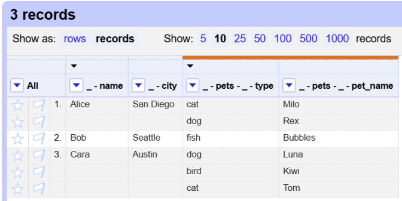
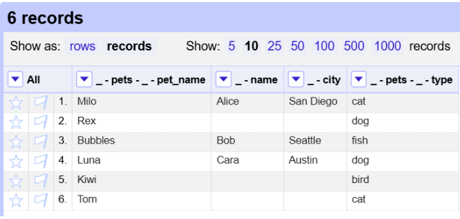
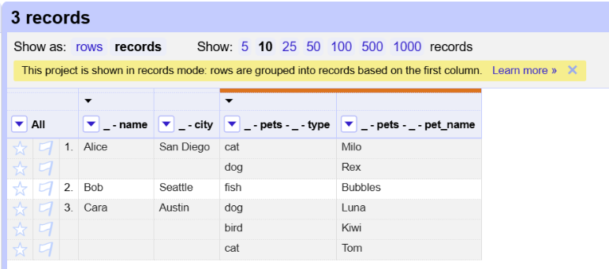
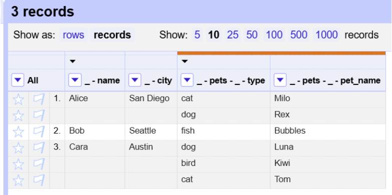

# Process Journal (OpenRefine)

**Issue:** https://github.com/OpenRefine/OpenRefine/issues/3360
**Pull request:** https://github.com/OpenRefine/OpenRefine/pull/8104
**Authors:** Ethan Pham and Kaley Chung

## 1. Feature Exploration

### Getting familiar with OpenRefine

We each ran OpenRefine locally and loaded a sample JSON file that Kaley made, with people, their rank and their pets. Switching to records mode reproduced the behavior from the issue: when we moved a different column to the first position, the pets were grouped under different records. Records are built from the first column, so changing that column changes which rows belong together.

**Before:**

**After:**

We also read `AGENTS.md` for the build and test commands, and the [Rows vs. records](https://openrefine.org/docs/manual/exploring#rows-vs-records) docs page that the issue points to.

### Deciding what to build

The issue thread changed our plan. The original report asked to change how row boundaries are formed, but the OpenRefine creator said that behavior is intended. Instead, he asked for a "small information message" telling users records mode is on, which we built.

The request was open to interpretation, so we settled these questions one at a time with Codex:

- **When does it show?** Any time the grid is in records mode, rather than only when a project is created or a column is swapped. One check covers opening a project, clicking "records" and restoring a saved view, and it doesn't miss users who never swap columns.
- **Once, or until dismissed?** Until the user dismisses it, like OpenRefine's other notices (the update check and the history warning).
- **Where does it go?** A banner right under the "Show as: rows / records" toggle, next to the thing it explains. A pop-up dialog would block the page.
- **How is it dismissed?** A ✕ with a "Don't show again" tooltip, matching other ✕ buttons in OpenRefine and making clear it's permanent.
- **Does the docs link dismiss it?** No. Only an explicit click on ✕ should hide it for good.
- **What about rows mode?** The banner hides but isn't dismissed, so it comes back in records mode.
- **How is the dismissal remembered?** As a workspace preference, the same way other "don't show again" settings are saved. It works in any browser, and tests can set it.

## 2. Comprehension Process

We started from the question "where does OpenRefine decide it's in records mode?" and followed the code outward from there. Each step answered one question and pointed to the next.

### Navigation path

1. **Where is the mode set?** Searching `record-based` led to `browsing-engine.js`, which sets the mode from `hasRecords`, and to `data-table-view.js`, which draws the rows/records toggle.
2. **What triggers a mode change?** Searching `setMode` and `getMode` showed three paths (project open, clicking the toggle, restoring a saved view). All three end in `DataTableView.render()`, so that became our hook.
3. **When is `hasRecords` true?** In `RecordModel.java`, it's true when there are fewer records than rows. This is how we learned that a CSV with blank cells in the first column also opens in records mode.
4. **Is there a notice we can copy?** Searching `notification`, `banner` and `dismiss` found the update-check banner in `index.js`, the progress/undo box in `process-panel.js` and the history-erasure warning in `project.js`.
5. **How is "don't show again" saved?** Searching `setPreference` led to `Refine.setPreference` in `project.js`. We then read `PreferenceStore.loadObject()` to check what type a saved value comes back as.
6. **How is the header laid out?** Reading `render()` and `resize()` showed that the header is rebuilt on every update, and that `resize()` measures its height.
7. **What do ✕ buttons and docs links look like elsewhere?** Searching `close.svg`, `facet-title-remove` and `learn-more` gave us patterns to follow.
8. **Which tests should we extend?** Searching the Cypress specs for `records` and `setPreference` found `rows_records.cy.js`, plus specs that save and restore a preference.

### Techniques and commands

- **Text search** across `main/webapp/modules/core/scripts` was our main tool, with `grep -rn "<term>"` or VS Code's search (Ctrl + Shift + F).
- **Go to Definition** (F12 in VS Code) to jump from a call like `Refine.setPreference` to where it's defined.
- `git show HEAD:<file>` and `git diff --stat` to compare our changes against the committed code.
- `node --check <file>` to catch JavaScript syntax errors before building.
- `refine.bat build` to build, and `refine.bat /p 3334 /d <empty folder>` to start a separate test server.
- `netstat -ano | findstr :3334` and `taskkill /PID <pid> /F` to find and stop a server still using the port.

### Debugger

We didn't set any breakpoints. Instead, we used the browser's developer console (F12) to check for JavaScript errors while testing the banner, and relied on code search and the Cypress test output to understand what the code was doing.

## 3. Implementation Process

We worked together in VS Code Live Share the whole time, so we were both in the same files at once. Neither of us held a fixed role: we both drove and navigated in every step below.

1. **Reproduced the issue** with the sample JSON and read the issue thread. We each did this on our own machine first.
2. **Made the design decisions** one by one after asking Claude to help think through the notice.
3. **Added `_renderRecordsModeNotice()`** in `data-table-view.js` and called it from `render()`.
4. **Added the banner CSS and two translation strings**, reusing the existing "Learn more »" text.
5. **Fixed an existing test** that the banner broke, and added tests for the notice.
6. **Added 3 more tests** (Kaley): dismissed without a reload, dismissed across projects, and only one banner after a redraw.
7. **Built OpenRefine**, ran the spec on a separate test server and checked the banner by hand.
8. **Committed and opened [PR #8104](https://github.com/OpenRefine/OpenRefine/pull/8104).**

**When we switched roles:** We didn't switch at set points. Because Live Share let us both type in the same session, whoever had the next idea or spotted a problem took over, often several times within one step.

**How the roles affected the work:** Sharing one session meant we always saw the same code and the same agent output, so we never had to merge two versions or catch each other up. The tradeoff is that with no fixed navigator, we had to make a point of stepping back to review what had just been written, instead of both focusing on typing.

## 4. Running and Testing

### Automated tests (`rows_records.cy.js`)

We ran the spec against a separate OpenRefine server on port 3334 with an empty workspace, so our real projects were never touched. All 9 tests pass.

- **Rows vs. records for a CSV (existing):** same 10 rows in both modes.
- **Rows vs. records for JSON (existing, fixed):** "records" shows in the toggle, summary bar and page size.
- **Notice in records mode:** banner shows, the link opens the docs in a new tab, ✕ says "Don't show again".
- **Rows mode:** banner hides, then comes back in records mode.
- **CSV switched to records by hand:** no banner in rows, banner after clicking "records".
- **Dismissed stays dismissed:** banner stays gone after ✕ and a reload.
- **Dismissed without reload (added later by Kaley):** after clicking ✕, switching to rows and back to records keeps the banner gone.
- **Dismissed across projects (added later by Kaley):** once dismissed, a different records project shows no banner.
- **One banner after redraw (added later by Kaley):** changing the page size still leaves exactly one banner.

### Manual verification

We started OpenRefine on port 3334, loaded a JSON file of people and their pets, and checked:

- The yellow banner shows under "Show as: rows / records" in records mode.
- "Learn more »" opens the rows vs. records docs page in a new tab, and the banner stays.
- Clicking "rows" hides the banner; clicking "records" brings it back.
- Clicking ✕ removes the banner and the grid grows to fill the space.
- After a reload or restart, the banner stays gone.

**Before:**

**After dismiss:**

### Edge cases

- **A CSV with blank first-column cells opens in records mode.** The notice shows, since these users are the most likely to be confused.
- **The header is rebuilt on every update.** The banner is redrawn each time from the current state, not added once.
- **Paging, facets and other redraws.** A test makes sure the banner never appears twice.
- **The saved preference could come back as the text `"true"`.** The check accepts both `true` and `"true"`.
- **Tests share one workspace**, so a dismissal could leak into the next test. We save the preference before the tests, clear it before each one and restore it after.
- **An existing test counted every element containing "records".** The banner added one more, so we pointed the test at the specific labels.

### Write → Run/Test → Debug loop

- **Wrote the notice, CSS, strings and tests.** Ran `node --check` and parsed the JSON. No problems.
- **Wrote the Cypress spec.** `prettier --check` reported style errors. They were only Windows line endings, and it passes with `--end-of-line auto`.
- **Built with `refine.bat build`.** Maven failed on `modules/grel/pom.xml`, an unrelated half-finished local edit. We restored the file.
- **Started with `./refine` in Git Bash.** Got `ClassNotFoundException`. Switched to `refine.bat`.
- **Passed a `name=value` option to `refine.bat`.** Got `Unknown Refine command`. Set `JAVA_OPTIONS` in the environment instead.
- **Ran `yarn install` in WSL.** Got `node: not found`, then `EEXIST` from the Windows npm. Redid the setup in PowerShell with `npx corepack yarn install`.
- **Restarted OpenRefine.** Got `Address already in use` on port 3334. Found the old process with `netstat` and stopped it with `taskkill`.
- **Checked the banner after a restart.** It didn't come back. Not a bug: the ✕ was saved in the workspace, so we started with a new empty folder.
- **Ran `cypress run`.** Tests passed.

## 5. Obstacles Encountered

1. **The build broke because of a file we never touched.** `modules/grel/pom.xml` had a half-finished local edit, and Maven refused to build. We read the error, compared the file with `git show HEAD:`, and stopped to check rather than "fixing" someone else's work. Restoring the file fixed it. *Next time:* when a build breaks somewhere unexpected, check `git status` for stray edits first.
2. **`./refine` doesn't work on Windows.** It failed with `ClassNotFoundException`. *Fix:* use `refine.bat`.
3. **`refine.bat` splits options at `=`.** Passing `refine.headless=true` turned into a command called `true`. *Fix:* set `JAVA_OPTIONS` before running `refine.bat`.
4. **Mixing WSL and PowerShell.** Running `yarn install` in WSL failed with `node: not found`, because Node was only installed on Windows. WSL then ran the Windows `npm`, which failed with `EEXIST` on an old global Yarn. *Fix:* do all the Node and Cypress setup in PowerShell, with `npx corepack yarn install` and `YARN_NODE_LINKER=node-modules`. *Next time:* pick one terminal for the whole project.
5. **Yarn version and Node 25.** The project needs Yarn 4, but Yarn 1.22 was installed globally, and Yarn's Plug'n'Play mode crashed on Node 25. *Fix:* `npx corepack` with the `node-modules` linker. *Next time:* use Node 24, the version the project targets.
6. **"Address already in use" when restarting.** Closing the browser left OpenRefine running on port 3334. *Fix:* `netstat -ano | findstr :3334` to find the process ID, then `taskkill /PID <id> /F`. *Next time:* stop the server with Ctrl + C in its terminal.
7. **The banner didn't come back after a restart.** We first thought the feature was broken. It was working as designed: the ✕ was saved as a preference in the workspace folder. *Fix:* start with a new empty folder (`/d C:\temp\refine-test2`) or delete the preference.
8. **Our banner broke an existing test.** That test counted every element containing "records", and the banner added one more. *Fix:* point the test at the specific labels instead.

## 6. Resources Consulted

- **Claude (agentic tool):** searched the codebase and found existing patterns with file and line numbers, laid out options and tradeoffs for each decision, wrote the code and tests we agreed on, and helped debug the Windows setup (ports, WSL vs. PowerShell, Yarn).
- **[Issue #3360](https://github.com/OpenRefine/OpenRefine/issues/3360) discussion:** the records behavior is intended, and the maintainers wanted a small, visible, dismissible message instead.
- **[OpenRefine docs: Rows vs. records](https://openrefine.org/docs/manual/exploring#rows-vs-records):** how records are formed from the first column. It's the page our banner links to.
- **`AGENTS.md` in the repo:** build, test and lint commands, and that new text only goes in the English translation file.
- **Existing code** (`index.js`, `project.js`, `process-panel.js`, `list-facet.js`): how OpenRefine already does banners, "don't show again" preferences and ✕ buttons.
- **Existing tests** (`rows_records.cy.js` and specs that save a preference): how to test the grid, and how to save and restore a preference in a test.

## 7. Reflection

### How did you and your partner interact with AI and what was AI's role in this collaborative process?

We used the agent to find things and lay out choices, and kept the decisions for ourselves. It searched the codebase, pointed to existing patterns, explained tradeoffs, and wrote the code once we agreed on a plan. We went through the design questions one at a time and asked for short answers.

We pushed back when a suggestion didn't seem to fit OpenRefine:

- We asked whether showing the notice every time matched existing patterns, which led to "show until dismissed".
- We asked whether the ✕ and the docs link behaved like similar buttons elsewhere in OpenRefine.
- We questioned hiding the banner in every other test. The agent changed its recommendation, and we fixed the one test that broke instead.

We also set a rule that the agent had to stop and ask at big decisions. It did, for example when it found the broken `pom.xml` instead of editing it.

### How did you manage navigating different contexts while pair programming?

We worked from one laptop and shared it over VS Code Live Share, so there was only one copy of the code and one agent conversation to follow. That kept us from making conflicting changes. We talked through each agent answer together before moving on, and asked the agent about one decision at a time instead of letting it plan everything at once. The agent laid out the options, but we made every final decision ourselves.

### What did you learn from writing this process journal?

Writing this journal showed us how much it helps to document progress as we go. Keeping notes made it easier to track what was done and what was still needed. It also reminded us that we should own the decisions, and that issues we noticed in the agent's output were ours to raise and fix, not something to accept as-is.

### What will you take away from this experience for future work?

- **Read the whole issue thread first.** It changed our feature from "change how records work" to "explain how records work".
- **Look for an existing pattern before designing something new.** Most of our decisions came down to "what does OpenRefine already do?"
- **Test against a separate, empty workspace.** It protects your real data, and it explains "bugs" like a dismissed banner staying hidden.
- **Pick one terminal for setup.** Mixing WSL and PowerShell cost us time.
